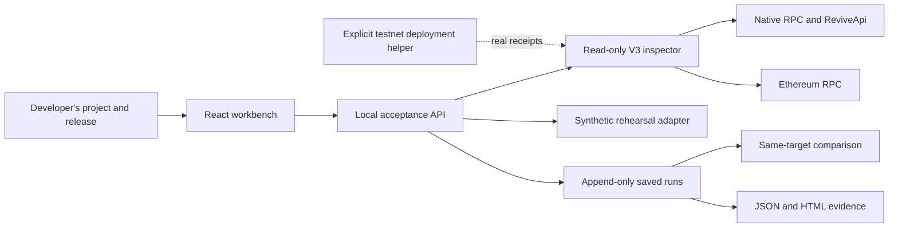

# ReviveCheck

Release acceptance and reviewer handoff for Portaldot V3 applications.

[DoraHacks submission: Under Review](https://dorahacks.io/build/50176) · [Public report reviewer](https://a252937166.github.io/ReviveCheck/) · [Original Check-in video](https://a252937166.github.io/ReviveCheck/check-in.mp4) · [Original Check-in deck](artifacts/ReviveCheck-Check-in-Deck.pdf)

**Define the release checks, inspect the real target, correct a failure, and hand the exact report to a reviewer.** Preserve that review with its report; create a new check when the release, plan, deployment, or runtime changes.

The v0.2 workbench uses the real V3 testnet. Its static public reviewer verifies report integrity without a backend or wallet. The included public pUSD report verifies an existing native asset against its ERC-20 precompile; it does not claim we created that asset or have an independent customer. Our own ReleaseGate deployment and state writes remain pending test-token funding. The original video/deck document v0.1. See [v0.2 evidence and validation](docs/RELEASE_V2.md).

## Run it

Requires Node.js 22 or newer.

```sh
npm ci
npm run dev
```

Open <http://127.0.0.1:4173>. To serve the production build locally:

```sh
npm run build
npm start
```

The server binds to loopback, rejects other origins, and is intended for one local developer. It has no multi-user authentication and should not be exposed publicly as-is. Project and run history are stored in `.revivecheck/workspace.json`, outside Git. Restarting the server retains that history. There is no wallet secret in the browser or API.

## Complete one lifecycle

1. **Define your release plan.** Save a logical contract, release/source version and deployment. Configure up to eight view assertions with stable IDs, arguments and expected results. Supported scalar types are `uint256`, `address`, `bool`, `string`, and `bytes32`. Legacy `value()` plans still work. Alternatively select native asset acceptance to check supply, holder balance and precision through both native Assets and its ERC-20 precompile.
2. **Find a failure.** Rehearse a wrong network, or use live read-only mode to inspect your actual target. Live checks pin the V3 genesis and chain ID, establish a shared finalized checkpoint, resolve account mapping, inspect funding and code, read the value through both interfaces, and verify a supplied contract transaction.
3. **Correct and rerun.** Every run is a new saved record. Saving project settings never rewrites an earlier run.
4. **Compare the context.** Same-deployment configuration corrections, new deployments of the same explicit logical contract, changed assertion plans, runtime drift and synthetic scenario changes have distinct comparison semantics. Context changes are not counted as code repairs.
5. **Share the report.** Download JSON/HTML or prepare a compressed link for the public static reviewer. The fragment remains in the recipient's browser. QR codes contain the report when small enough; longer reports use the viewer plus an explicit JSON-file handoff. Published public reference reports also have short, verified links and QR codes.
6. **Record a review.** The reviewer downloads a decision receipt bound to the exact report hash. Import it into the local workspace, or record a local review. Reviewer names are self-declared, not authenticated official approvals. Neither a review nor a share changes the sealed report.
7. **Recheck.** A changed release, plan, deployment or observed runtime marks older evidence for rechecking. Recheck creates a new run; earlier reviews never transfer automatically. Archive/restore keeps the history.

Rehearsal passing proves the product workflow, not a Portaldot deployment. Live read-only passing verifies supplied state and transaction evidence; it does not itself deploy or execute a write. Historical transaction provenance is separate from the current state assertion.

## Meaningful V3 integration

The deployed runtime was inspected rather than assumed equivalent to Ethereum:

- Native and EVM addresses are resolved through `ReviveApi` and checked for a matching round trip.
- Native and EVM block hashes differ. Both interfaces are anchored to the same finalized height using `ReviveApi.ethBlockHash`.
- Native token precision and EVM balances are kept separate, with runtime-reported conversion data.
- Native Assets and ERC-20 precompile supply, holder balance and precision are compared at one finalized checkpoint. The adapter is explicitly scoped to the observed spec 3002 address scheme.
- Asset-paid native extrinsics are decoded using spec-scoped types, including historical registries. A real block that fails with default polkadot.js types is retained as an offline regression fixture.
- Native Solidity deployment has a reproducible constructor encoding trap: separate native constructor data returns `EvmConstructorNonEmptyData`; appending the ABI argument to EVM initcode succeeds in a real read-only simulation.

See [technical findings and limitations](docs/CHAIN_FINDINGS.md) and [the recorded negative/corrected simulation](artifacts/constructor-dryrun.json). A successful simulation is not a persistent deployment.

## Inspect or reproduce from the terminal

```sh
npm test
node scripts/compile-probe.js
node scripts/probe-constructor-dryrun.js
node scripts/check-live.js --account <your-public-native-or-evm-address>
node scripts/run-plan.js examples/probe.plan.json --out artifacts/local/my-report.json
node scripts/run-plan.js examples/public-asset.plan.json --out artifacts/local/public-asset.json
node scripts/verify-report.js artifacts/local/my-report.json
```

Live inspection requires network access to the official RPCs. A blocked or failed inspection exits nonzero; missing account, code, or transaction evidence never passes by default. The sample plan needs your own deployed address and transaction evidence before it can pass. Its blank fields are intentional.

The SHA-256 fingerprint detects changes to the companion JSON payload. It is not a signature, on-chain attestation, or proof that the RPC operator is truthful. The HTML rendering is a reading aid; verify the JSON file with the CLI.

## Testnet execution

The developer helper reads an isolated native sr25519 wallet from `.private/wallet.json`. Do not copy that file, a seed, or any private note into issues, reports, or the repository.

```sh
# Read-only estimate. No transaction is signed.
node scripts/deploy-probe.js --wallet .private/wallet.json

# Only after test-token funding and review of that estimate:
node scripts/deploy-probe.js --wallet .private/wallet.json --broadcast --max-cost-tpot 100
```

The example budget is in test tokens, covers a storage-deposit limit plus an estimated fee, and is not a guarantee of actual cost. This script pins the official testnet, checks mapping and available funds, and records individual finalized receipts. It does not purchase tokens. A finalization timeout is an unknown outcome: inspect the original transaction before retrying.

The constructor starts with the requested initial value. A separate state update and finalized dual-interface readback are required before claiming a complete write/readback execution demo. The product UI remains read-only.

The v0.2 application fixture is `ReleaseGate`: an owner submits a report commitment, a configured reviewer accepts/rejects it, and a new submission resets approval. The test execution helper deploys, submits, reviews and performs finalized dual-interface assertions:

```sh
node scripts/compile-release-gate.js
# No signing; reports funding/estimate readiness.
node scripts/execute-release.js
# Explicit testnet-only cap, after funding and reviewing the estimate:
node scripts/execute-release.js --broadcast --max-cost-tpot 100
```

The isolated test signer occupies both roles in this facilitated contract demonstration. It is not independent review or adoption. Maximum storage deposits plus a conservative fee reserve are checked cumulatively against the estimate cap; actual fee changes cannot be strictly capped by this helper. A pending journal entry stops automatic retries after an uncertain outcome. Deployment, writes and readback are only complete when the actual receipts and passing report exist.

## Architecture and materials



- [Product, innovation hypothesis, lifecycle, adoption gates](docs/PRODUCT.md)
- [Check-in description and honest progress ledger](docs/CHECK_IN.md)
- [Delivered 78-second demonstration and captions](docs/DEMO_SCRIPT.md)
- [Test-token request and manual support follow-up](docs/TOKEN_REQUEST.md)
- [API contract](docs/API.md)
- [Manual acceptance record](docs/VALIDATION.md)

No independent adoption, saved developer hours, customer revenue, production audit, or arbitrary EVM equivalence is claimed. The next product test is an external builder bringing their own compatible contract and reviewing a second run without the author explaining the raw logs.

## Attribution and license

New ReviveCheck application code was created during this Hacker House. Dependencies include React, Vite, Express, Polkadot.js, solc, and Lucide; their licenses remain with their respective owners. Network integration was informed by the [officially recommended V3 guide](https://github.com/ItsCogumellum/portaldot-v3-testnet-guide), the [V3 FAQ](https://github.com/ItsCogumellum/portaldot-v3-testnet-guide/blob/main/FAQ.md), and live runtime metadata. We did not import an existing complete product as the competition work.

Application source is MIT licensed; see [LICENSE](LICENSE).
