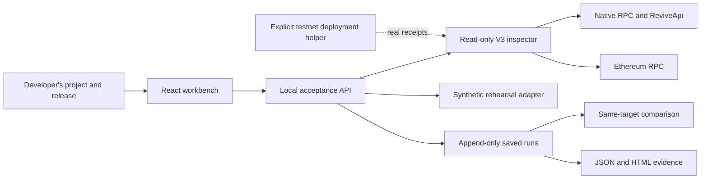

# ReviveCheck

Repeatable release acceptance for Solidity applications moving to Portaldot V3.

[Watch the 78-second Check-in video](https://a252937166.github.io/ReviveCheck/) · [Pitch Deck (PDF)](artifacts/ReviveCheck-Check-in-Deck.pdf) · [Public source](https://github.com/a252937166/ReviveCheck)

**Catch a migration failure, correct the same project, rerun the checks, and show what changed.** ReviveCheck preserves the original inputs and evidence so the next maintainer can review the result instead of reconstructing screenshots and RPC logs.

This is a local Check-in prototype. Its live inspector uses the actual Portaldot V3 testnet; the included rehearsal uses explicitly synthetic fixtures. Our own signed deployment is not claimed until a real receipt is recorded. See [current evidence and pending items](docs/CHECK_IN.md).

## Run it

Requires Node.js 22 or newer.

```sh
npm ci
npm run dev
```

Open <http://127.0.0.1:4173>. To serve the production build locally:

```sh
npm run build
npm start
```

The server binds to loopback, rejects other origins, and is intended for one local developer. It has no multi-user authentication and should not be exposed publicly as-is. Project and run history are stored in `.revivecheck/workspace.json`, outside Git. Restarting the server retains that history. There is no wallet secret in the browser or API.

## Complete one lifecycle

1. **Create your project.** Save a release, expected chain ID, public deployer address, contract address, and expected `value()` result. The initial contract assertion supports the included ReviveProbe ABI, or another compatible `value() -> uint256` getter; arbitrary application tests are outside this version.
2. **Find a failure.** Rehearse a wrong network, or use live read-only mode to inspect your actual target. Live checks pin the V3 genesis and chain ID, establish a shared finalized checkpoint, resolve account mapping, inspect funding and code, read the value through both interfaces, and verify a supplied contract transaction.
3. **Correct and rerun.** Every run is a new saved record. Saving project settings never rewrites an earlier run.
4. **Review the change.** Choose a baseline from the same project and evidence scope. Changing the contract, account, or expected value cannot be reported as repairing the same acceptance target. A network configuration correction is explicitly distinguished from an application code fix.
5. **Keep the evidence.** Download JSON for integrity verification or HTML for reading. Reopen history for the next release; archive and restore the project without discarding its reports.

Rehearsal passing proves the product workflow, not a Portaldot deployment. Live read-only passing verifies supplied state and transaction evidence; it does not itself deploy or execute a write. Historical transaction provenance is separate from the current state assertion.

## Meaningful V3 integration

The deployed runtime was inspected rather than assumed equivalent to Ethereum:

- Native and EVM addresses are resolved through `ReviveApi` and checked for a matching round trip.
- Native and EVM block hashes differ. Both interfaces are anchored to the same finalized height using `ReviveApi.ethBlockHash`.
- Native token precision and EVM balances are kept separate, with runtime-reported conversion data.
- Native Solidity deployment has a reproducible constructor encoding trap: separate native constructor data returns `EvmConstructorNonEmptyData`; appending the ABI argument to EVM initcode succeeds in a real read-only simulation.

See [technical findings and limitations](docs/CHAIN_FINDINGS.md) and [the recorded negative/corrected simulation](artifacts/constructor-dryrun.json). A successful simulation is not a persistent deployment.

## Inspect or reproduce from the terminal

```sh
npm test
node scripts/compile-probe.js
node scripts/probe-constructor-dryrun.js
node scripts/check-live.js --account <your-public-native-or-evm-address>
node scripts/run-plan.js examples/probe.plan.json --out artifacts/local/my-report.json
node scripts/verify-report.js artifacts/local/my-report.json
```

Live inspection requires network access to the official RPCs. A blocked or failed inspection exits nonzero; missing account, code, or transaction evidence never passes by default. The sample plan needs your own deployed address and transaction evidence before it can pass. Its blank fields are intentional.

The SHA-256 fingerprint detects changes to the companion JSON payload. It is not a signature, on-chain attestation, or proof that the RPC operator is truthful. The HTML rendering is a reading aid; verify the JSON file with the CLI.

## Testnet execution

The developer helper reads an isolated native sr25519 wallet from `.private/wallet.json`. Do not copy that file, a seed, or any private note into issues, reports, or the repository.

```sh
# Read-only estimate. No transaction is signed.
node scripts/deploy-probe.js --wallet .private/wallet.json

# Only after test-token funding and review of that estimate:
node scripts/deploy-probe.js --wallet .private/wallet.json --broadcast --max-cost-tpot 100
```

The example budget is in test tokens, covers a storage-deposit limit plus an estimated fee, and is not a guarantee of actual cost. This script pins the official testnet, checks mapping and available funds, and records individual finalized receipts. It does not purchase tokens. A finalization timeout is an unknown outcome: inspect the original transaction before retrying.

The constructor starts with the requested initial value. A separate state update and finalized dual-interface readback are required before claiming a complete write/readback execution demo. The product UI remains read-only.

## Architecture and materials



- [Product, innovation hypothesis, lifecycle, adoption gates](docs/PRODUCT.md)
- [Check-in description and honest progress ledger](docs/CHECK_IN.md)
- [Delivered 78-second demonstration and captions](docs/DEMO_SCRIPT.md)
- [Test-token request and manual support follow-up](docs/TOKEN_REQUEST.md)
- [API contract](docs/API.md)
- [Manual acceptance record](docs/VALIDATION.md)

No independent adoption, saved developer hours, customer revenue, production audit, or arbitrary EVM equivalence is claimed. The next product test is an external builder bringing their own compatible contract and reviewing a second run without the author explaining the raw logs.

## Attribution and license

New ReviveCheck application code was created during this Hacker House. Dependencies include React, Vite, Express, Polkadot.js, solc, and Lucide; their licenses remain with their respective owners. Network integration was informed by the [officially recommended V3 guide](https://github.com/ItsCogumellum/portaldot-v3-testnet-guide), the [V3 FAQ](https://github.com/ItsCogumellum/portaldot-v3-testnet-guide/blob/main/FAQ.md), and live runtime metadata. We did not import an existing complete product as the competition work.

Application source is MIT licensed; see [LICENSE](LICENSE).
