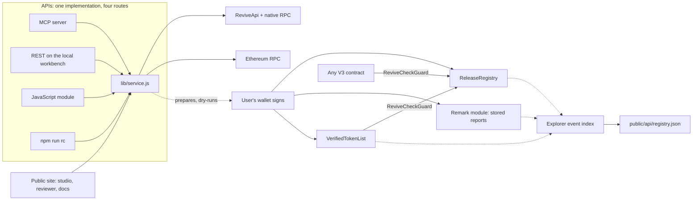

# ReviveCheck

Release attestation middleware for Portaldot V3: a registry other contracts can trust, evidence stored on-chain, and a verification API for agents, apps and CI.

[](https://github.com/a252937166/ReviveCheck/actions/workflows/ci.yml) [](LICENSE) [](https://scanner-testnet-v3.portaldot.dev/#/extrinsics/0xc099451a308eab45a2a29c1f1d628290d067c69250f129ad7aab145235c8aeea) [](https://dorahacks.io/hackathon/portaldot-hacker-house-2026/detail)

[DoraHacks submission: Under Review](https://dorahacks.io/build/50176) · [Current baseline reviewer](https://a252937166.github.io/ReviveCheck/?report=0272674216c3687911b6e97349414d39a31eb49c8173c02919262dfafc9dc0d5#/review) · [Verified v0.2 lifecycle walkthrough](https://a252937166.github.io/ReviveCheck/lifecycle-demo-v0.2.mp4) · [Original Check-in video](https://a252937166.github.io/ReviveCheck/check-in.mp4) · [Original Check-in deck](artifacts/ReviveCheck-Check-in-Deck.pdf)

**Define the release checks, inspect the real target, correct a failure, and hand the exact report to a reviewer.** Preserve that review with its report; create a new check when the release, plan, deployment, or runtime changes.

## What it is

ReviveCheck provides three components, all built on Portaldot V3's runtime modules and all deployed and recorded on the V3 testnet:

| Component | What it is | On the V3 testnet |
| --- | --- | --- |
| **Decentralized middleware** | `ReleaseRegistry`, an open contract where a release owner commits a sealed report's hash and reviewers approve that exact hash, with every new submission opening an unapproved revision. `ReviveCheckGuard`, a Solidity library any contract uses to act on those approvals. `VerifiedTokenList`, the reference consumer. | Registry `0xe949b200edf070b9d425b206ed24dc8fe5b7d339` (block 162962). Token list `0xd0bd833b4b8658b1230a0e9a99640935b3c65819` (block 164220). pUSD listed on an approved release in block 164313, read back through both interfaces. |
| **Storage and data** | Sealed reports stored on the chain itself through the native Remark module (`remark.store`), retrievable and verifiable from any node by two hashes. A public feed, `public/api/registry.json`, built from chain events. | Reports stored in blocks 164266 and 164335 (7,404 bytes, about 0.75 tPOT each). |
| **APIs** | Twelve read-only tools that check releases through both V3 interfaces at one finalized block, assess promotion against V3 Live, and read every contract back through both interfaces. Served over MCP, REST, JavaScript and the CLI from one implementation. Writes are dry-run, then signed in the user's own wallet. | `npm run mcp`, `npm run rc -- <tool>`, `POST /api/tools/<name>` on the local workbench. |

Portaldot modules used: **Revive** (the contracts, reachable as EVM transactions or native `revive.call`), **ReviveApi** (account and block mapping between the interfaces), **Assets and its ERC-20 precompile** (the demo release's parity checks), and **Remark** (evidence storage).

## See it live

The public site, <https://a252937166.github.io/ReviveCheck/>, opens into an app (`#/app`) with the registry's releases, listings, stored reports and activity, each row linked to its block, plus live lookups through the same service the MCP server uses. The landing shows the lifecycle as eight stages on the recorded run of the pUSD token list, each linked to its block: check (v1.0.0 fails on decimals), recheck (v1.0.1 passes), store (the report on-chain), submit and approve (the registry), consume (the token list acts on the approval), promote (V3 Live refuses the release: chain 780780777, runtime 3001, no asset 7777) and watch (both runtimes, live).

**Run the lifecycle** (`#/app/run`, inside the app at `#/app`) runs every stage on the real testnet from the browser. Reads need nothing. Storing, submitting, approving, listing and the review remark are signed in a Polkadot wallet (EVM wallets cover the two registry calls), each after a dry-run, and paid with the visitor's own testnet tPOT: the site holds no key and spends nothing. On 2026-10-23 a full run through the studio UI signed submit (block 163485), approve (163489) and a remark (163493) with the project test wallet.

```sh
claude mcp add revivecheck -- node "$PWD/mcp/server.js"      # Claude Code
npm run rc -- token_list_status --token 0x00001E6100000000000000000000000000010000
```

The full record, with every hash and link, is in [docs/LIFECYCLE.md](docs/LIFECYCLE.md). The integration guide is [docs/INTEGRATION.md](docs/INTEGRATION.md), also at `#/docs`. The mark and the "Built on Portaldot V3" co-brand are described in [docs/BRAND.md](docs/BRAND.md).

## Why it is different

| | Today | With ReviveCheck |
| --- | --- | --- |
| Where the approval lives | A JSON token list, a spreadsheet or a chat thread. No contract can read it. | A hash in the `ReleaseRegistry`. Any V3 contract reads it through the `ReviveCheckGuard` library in three lines of Solidity. |
| What was approved | "The release", with no record of what the reviewer saw. | The exact report hash the reviewer named. A new revision clears every decision, so nothing carries over silently. |
| The evidence | A screenshot, or a link whose content can change. | The sealed report itself, stored on Portaldot through the native Remark module and retrievable from any node by its SHA-256 and its blake2 content hash. |
| Checking the chain | Someone opens an explorer and reads one interface. | One API reads the native runtime and the EVM RPC at the same finalized block, and the two must agree. Served over MCP, REST, JavaScript and the CLI. |
| Going to V3 Live | A testnet pass is assumed to carry over. | V3 Live itself is read first; a different chain ID, runtime or missing asset refuses the release. |

What V3 makes possible here, and what the design leans on: the same contract is reached as an EVM transaction or a native `revive.call`, and read back through both `eth_call` and `ReviveApi.call`; the evidence store is a runtime module (`remark.store`), not a contract; and the promotion check is a read of a second Portaldot network.

## Who it is for

- **Token issuers and listing teams.** Publish a token-list release with proof that the chain agrees, and let wallets and DEX allow-lists read the approval on-chain instead of trusting a file. The pUSD release on the testnet is the worked example.
- **Protocol teams gating launches.** Put a launchpad, a router allow-list or an upgrade behind an approved release. `VerifiedTokenList` is the reference consumer; the guard works for any contract.
- **Reviewers, auditors, agents and CI.** Check a release through both V3 interfaces, replay it at its block, and sign a decision from a wallet or a pipeline. The MCP server gives an agent the same twelve tools.

**Business model, as a hypothesis.** The contracts, the library and the API stay open source under MIT. What a team would pay for: a hosted verification and indexing service so they do not run the API and the event indexer themselves, curated reviewer registries operated for an ecosystem (a chain, a launchpad, a wallet's listing desk), and CI integrations with retention of reports. None of this is validated with a paying customer yet; the next product test is an external builder bringing their own contract.

## Roadmap

- A second, independent reviewer account for the recorded demo, so owner and reviewer are no longer one test account.
- A curated `VerifiedTokenList` deployment with a pinned reviewer, and a second consumer beyond token lists (a launchpad or DEX allow-list).
- Gasless reviewer decisions through V3's `MetaTx` module, so a reviewer signs without holding tPOT.
- A GitHub Action that rechecks a release when the runtime changes, and a published npm package for the API.
- Retries and failover for the public RPC nodes, and an EVM-wallet signed run recorded end to end.

Contributions are welcome through issues and pull requests; `npm test` runs offline, including the compiled contracts in an in-memory EVM, and CI runs the same on every push.

## Run it

Requires Node.js 22 or newer.

```sh
npm ci
npm run dev
```

Open <http://127.0.0.1:4173>. To serve the production build locally:

```sh
npm run build
npm start
```

The server binds to loopback, rejects other origins, and is intended for one local developer. It has no multi-user authentication and should not be exposed publicly as-is. Project and run history are stored in `.revivecheck/workspace.json`, outside Git. Restarting the server retains that history. There is no wallet secret in the browser or API.

## Complete one lifecycle

1. **Define your release plan.** Save a logical contract, release/source version and deployment. Configure up to eight view assertions with stable IDs, arguments and expected results. Supported scalar types are `uint256`, `address`, `bool`, `string`, and `bytes32`. Legacy `value()` plans still work. Alternatively select native asset acceptance to check supply, holder balance and precision through both native Assets and its ERC-20 precompile.
2. **Find a failure.** Rehearse a wrong network, or use live read-only mode to inspect your actual target. Live checks pin the V3 genesis and chain ID, establish a shared finalized checkpoint, resolve account mapping, inspect funding and code, read the value through both interfaces, and verify a supplied contract transaction.
3. **Correct and rerun.** Every run is a new saved record. Saving project settings never rewrites an earlier run.
4. **Compare the context.** Same-deployment configuration corrections, new deployments of the same explicit logical contract, changed assertion plans, runtime drift and synthetic scenario changes have distinct comparison semantics. Context changes are not counted as code repairs.
5. **Share the report.** Download JSON/HTML or prepare a compressed link for the public static reviewer. The fragment remains in the recipient's browser. QR codes contain the report when small enough; longer reports use the viewer plus an explicit JSON-file handoff. Published public reference reports also have short, verified links and QR codes.
6. **Record a review.** The reviewer downloads a decision receipt bound to the exact report hash. Import it into the local workspace, or record a local review. Reviewer names are self-declared, not authenticated official approvals. Neither a review nor a share changes the sealed report.
7. **Recheck.** A changed release, plan, deployment or observed runtime marks older evidence for rechecking. Recheck creates a new run; earlier reviews never transfer automatically. Archive/restore keeps the history.

Rehearsal passing proves the product workflow, not a Portaldot deployment. Live read-only passing verifies supplied state and transaction evidence; it does not itself deploy or execute a write. Historical transaction provenance is separate from the current state assertion.

## Meaningful V3 integration

The deployed runtime was inspected rather than assumed equivalent to Ethereum:

- Native and EVM addresses are resolved through `ReviveApi` and checked for a matching round trip.
- Native and EVM block hashes differ. Both interfaces are anchored to the same finalized height using `ReviveApi.ethBlockHash`.
- Native token precision and EVM balances are kept separate, with runtime-reported conversion data.
- Native Assets and ERC-20 precompile supply, holder balance and precision are compared at one finalized checkpoint. The adapter is explicitly scoped to the observed spec 3002 address scheme.
- Asset-paid native extrinsics are decoded using spec-scoped types, including historical registries. A real block that fails with default polkadot.js types is retained as an offline regression fixture.
- Native Solidity deployment has a reproducible constructor encoding trap: separate native constructor data returns `EvmConstructorNonEmptyData`; appending the ABI argument to EVM initcode succeeds in a real read-only simulation.

See [technical findings and limitations](docs/CHAIN_FINDINGS.md) and [the recorded negative/corrected simulation](artifacts/constructor-dryrun.json). A successful simulation is not a persistent deployment.

## Explorer references and retained upgrade baseline

Live reports now include the [official V3 testnet explorer](https://scanner-testnet-v3.portaldot.dev/) and verified native block/extrinsic detail links. Contract and transaction QR codes are derived from complete, matching saved evidence. Missing targets stay pending. The current explorer has no verified H160 contract detail route and its EVM transaction route is disabled; those QR codes contain the actual plain address/hash, explicitly labeled **Address only** or **Hash only**. They are not payment requests or fabricated explorer links. Browser reports offer SVG/PNG downloads; standalone HTML includes the same scoped references and SVG QR.

The [current immutable baseline manifest](public/baselines/current-2026-10-23.json) retains report **`0272674216c3687911b6e97349414d39a31eb49c8173c02919262dfafc9dc0d5`** at finalized block **157790**, runtime **3002**, and its exact report/environment/plan hashes. The later minimal observation at **2026-10-23 04:49 EDT**, block **158114**, found the same environment. A new checkpoint alone does not establish an upgrade; this is not evidence of completing a recheck after a real runtime change.

```sh
# Minimal identity/runtime/constants observation; no signing or asset check if unchanged.
node scripts/check-upgrade.js
# Reuse a previous saved complete result to avoid repeating the same environment recheck.
node scripts/check-upgrade.js --previous-result artifacts/local/upgrade-checks/<saved>.result.json
```

Actual environment drift creates a new same-plan report and a context-aware comparison, without rewriting the baseline or inheriting its reviews. Unexpected chain identity stops for manual review. See [baseline, recheck and deduplication rules](docs/UPGRADE_BASELINE.md).

## Inspect or reproduce from the terminal

```sh
npm test
node scripts/compile-probe.js
node scripts/probe-constructor-dryrun.js
node scripts/check-live.js --account <your-public-native-or-evm-address>
node scripts/run-plan.js examples/probe.plan.json --out artifacts/local/my-report.json
node scripts/run-plan.js examples/public-asset.plan.json --out artifacts/local/public-asset.json
node scripts/verify-report.js artifacts/local/my-report.json
```

Live inspection requires network access to the official RPCs. A blocked or failed inspection exits nonzero; missing account, code, or transaction evidence never passes by default. The sample plan needs your own deployed address and transaction evidence before it can pass. Its blank fields are intentional.

The SHA-256 fingerprint detects changes to the companion JSON payload. It is not a signature, on-chain attestation, or proof that the RPC operator is truthful. The HTML rendering is a reading aid; verify the JSON file with the CLI.

## Testnet execution

The developer helper reads an isolated native sr25519 wallet from `.private/wallet.json`. Do not copy that file, a seed, or any private note into issues, reports, or the repository.

```sh
# Read-only estimate. No transaction is signed.
node scripts/deploy-probe.js --wallet .private/wallet.json

# Only after test-token funding and review of that estimate:
node scripts/deploy-probe.js --wallet .private/wallet.json --broadcast --max-cost-tpot 100
```

The example budget is in test tokens, covers a storage-deposit limit plus an estimated fee, and is not a guarantee of actual cost. This script pins the official testnet, checks mapping and available funds, and records individual finalized receipts. It does not purchase tokens. A finalization timeout is an unknown outcome: inspect the original transaction before retrying.

The constructor starts with the requested initial value. A separate state update and finalized dual-interface readback are required before claiming a complete write/readback execution demo. The product UI remains read-only.

The v0.2 application fixture is `ReleaseGate`: an owner submits a report commitment, a configured reviewer accepts/rejects it, and a new submission resets approval. The test execution helper deploys, submits, reviews and performs finalized dual-interface assertions:

```sh
node scripts/compile-release-gate.js
# No signing; reports funding/estimate readiness.
node scripts/execute-release.js
# Explicit testnet-only cap, after funding and reviewing the estimate:
node scripts/execute-release.js --broadcast --max-cost-tpot 100
```

The isolated test signer occupies both roles in this facilitated contract demonstration. It is not independent review or adoption. Maximum storage deposits plus a conservative fee reserve are checked cumulatively against the estimate cap; actual fee changes cannot be strictly capped by this helper. A pending journal entry stops automatic retries after an uncertain outcome. Deployment, writes and readback are only complete when the actual receipts and passing report exist.

The v0.3 middleware uses the same helpers and caps:

```sh
node scripts/compile-release-registry.js && node scripts/compile-token-list.js
node scripts/deploy-registry.js --wallet .private/wallet.json                 # estimate; --broadcast --max-cost-tpot <n> to sign
node scripts/deploy-token-list.js --wallet .private/wallet.json [--curator 0x…] # the registry's reference consumer
node scripts/store-evidence.js --report <published report hash>                # remark.store estimate; --broadcast --max-fee-tpot <n>
node scripts/list-token.js --wallet .private/wallet.json                       # list pUSD on your approved release; dry-run by default
node scripts/index-registry.js                                                 # rebuild public/api/registry.json from chain events
node scripts/record-studio-run.js <session.json>                               # publish a studio session after re-reading the chain
```

Deployed on 2026-10-23: ReleaseRegistry at block 162962, VerifiedTokenList at 164220 (code deposit 178.158 tPOT), reports stored at 164266 and 164335, pUSD listed at 164313. Every record is in [docs/LIFECYCLE.md](docs/LIFECYCLE.md) with its extrinsic.


## Architecture and materials



- [How the project maps to the judging criteria, with gaps](docs/JUDGING_FIT.md)
- [Product, innovation hypothesis, lifecycle, adoption gates](docs/PRODUCT.md)
- [Check-in description and honest progress ledger](docs/CHECK_IN.md)
- [Delivered 78-second demonstration and captions](docs/DEMO_SCRIPT.md)
- [Verified 120-second v0.2 UI walkthrough](https://a252937166.github.io/ReviveCheck/lifecycle-demo-v0.2.mp4) and [scene/evidence/QA record](docs/DEMO_V2.md)
- [Test-token request and manual support follow-up](docs/TOKEN_REQUEST.md)
- [Integration guide: middleware, storage, API](docs/INTEGRATION.md)
- [API contract](docs/API.md)
- [Manual acceptance record](docs/VALIDATION.md)

No independent adoption, saved developer hours, customer revenue, production audit, or arbitrary EVM equivalence is claimed. The next product test is an external builder bringing their own compatible contract and reviewing a second run without the author explaining the raw logs.

## Attribution and license

New ReviveCheck application code was created during this Hacker House. Dependencies include React, Vite, Express, Polkadot.js, solc, and Lucide; their licenses remain with their respective owners. Network integration was informed by the [officially recommended V3 guide](https://github.com/ItsCogumellum/portaldot-v3-testnet-guide), the [V3 FAQ](https://github.com/ItsCogumellum/portaldot-v3-testnet-guide/blob/main/FAQ.md), and live runtime metadata. We did not import an existing complete product as the competition work.

Application source is MIT licensed; see [LICENSE](LICENSE).
