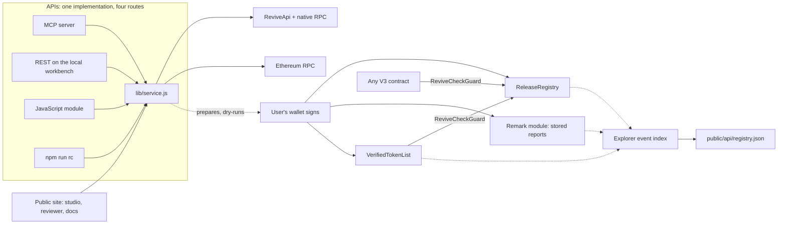

# ReviveCheck

Release attestation middleware for Portaldot V3: a registry other contracts can trust, evidence stored on-chain, and a verification API for agents, apps and CI.

[](https://github.com/a252937166/ReviveCheck/actions/workflows/ci.yml) [](LICENSE) [](https://scanner-testnet-v3.portaldot.dev/#/extrinsics/0xc099451a308eab45a2a29c1f1d628290d067c69250f129ad7aab145235c8aeea) [](https://dorahacks.io/hackathon/portaldot-hacker-house-2026/detail)

[DoraHacks submission: Under Review](https://dorahacks.io/build/50176) · [Current baseline reviewer](https://revivecheck.axiqo.xyz/?report=0272674216c3687911b6e97349414d39a31eb49c8173c02919262dfafc9dc0d5#/review) · [Verified v0.2 lifecycle walkthrough](https://a252937166.github.io/ReviveCheck/lifecycle-demo-v0.2.mp4) · [Original Check-in video](https://a252937166.github.io/ReviveCheck/check-in.mp4) · [Original Check-in deck](artifacts/ReviveCheck-Check-in-Deck.pdf)

**Define the release checks, inspect the real target, correct a failure, and hand the exact report to a reviewer.** Preserve that review with its report; create a new check when the release, plan, deployment, or runtime changes.

## What it is

ReviveCheck provides three components, all built on Portaldot V3's runtime modules and all deployed and recorded on the V3 testnet:

| Component | What it is | On the V3 testnet |
| --- | --- | --- |
| **Decentralized middleware** | `ReleaseRegistry`, an open contract where a release owner commits a sealed report's hash and reviewers approve that exact hash, with every new submission opening an unapproved revision. `ReviveCheckGuard`, a Solidity library any contract uses to act on those approvals. `VerifiedTokenList`, the reference consumer. | Registry `0xe949b200edf070b9d425b206ed24dc8fe5b7d339` (#162962). Historical v1 at `0xd0bd833b4b8658b1230a0e9a99640935b3c65819` (#164220), with pUSD listed at #164313 and dual-interface readback. V2 at `0xedaf8a25bb583ad164a94191b762414277198df9` (#177354), verified and active: pUSD listed at #187124 and again at #187205 on a separate reviewer account's approval, with the revision, revocation and restoration lifecycle recorded on 2026-10-25. |
| **Storage and data** | Sealed reports stored on the chain itself through the native Remark module (`remark.store`), retrievable and verifiable from any node by two hashes. A public feed, `public/api/registry.json`, built from chain events. | Reports stored in blocks 164266 and 164335 (7,404 bytes, about 0.75 tPOT each). |
| **APIs** | Thirteen read-only tools that check releases through both V3 interfaces at one finalized block, assess promotion against V3 Live, read every contract back through both interfaces, and evaluate a consumer's policy (network, subject, plan, runtime, evidence age, trusted reviewers) against fresh reads. Served over MCP, REST, JavaScript and the CLI from one implementation. Writes are dry-run, then signed in the user's own wallet. | `npm run mcp`, `npm run rc -- <tool>`, `POST /api/tools/<name>` on the local workbench. |

Portaldot modules used: **Revive** (the contracts, reachable as EVM transactions or native `revive.call`), **ReviveApi** (account and block mapping between the interfaces), **Assets and its ERC-20 precompile** (the demo release's parity checks), and **Remark** (evidence storage).

## See it live

The public site, <https://revivecheck.axiqo.xyz/>, opens into an app (`#/app`) with the registry's releases, listings, stored reports and activity, each row linked to its block, plus live lookups through the same service the MCP server uses. The landing shows the lifecycle as eight stages on the recorded run of the pUSD token list, each linked to its block: check (v1.0.0 fails on decimals), recheck (v1.0.1 passes), store (the report on-chain), submit and approve (the registry), consume (the token list acts on the approval), promote (V3 Live refuses the release: chain 780780777, runtime 3001, no asset 7777) and watch (both runtimes, live).

**Run the lifecycle** (`#/app/run`, inside the app at `#/app`) provides live read-only checks and wallet-signed storage, registry and remark actions. VerifiedTokenList v2 is deployed, verified and active, and pUSD is listed on it; the Catalog decision page (`#/app/catalog`) shows the recorded v2 lifecycle and evaluates the policy live in the browser. The v1 listing remains historical evidence, and shared write helpers refuse writes to that known-vulnerable deployment. A listing receipt saved by the studio counts only for the exact network, consumer version, token, release, revision and reviewer it was signed for; anything else is shown as history, and inclusion alone never shows Listed. Reads need no wallet; the site holds no key. On 2026-10-23 the studio signed submit (block 163485), approve (163489) and a remark (163493) with the project test wallet; listing and report storage were executed separately and remain linked historical evidence. The studio holds one explicit active report per browser-local project: a new check, recheck or imported report replaces it whatever its result, the receipts of the previous report become history, and every badge, lock and completion is derived from receipts that name the active report, the active submission and the registry's current revision (`src/studio-state.js`). **My projects** (`#/app/projects`) carries a visitor's own release through a policy draft, reviewer trust, a release label, the binding candidate shown with its exact report hash, explicit bindings, a live evaluation and the exported consumer configuration; **Evidence health** (`#/app/health`) states when the published evidence expires, which reads have lapsed, whether the approval and the listing stand, the next revision and the next role, and the planned renewal gap.

The [v0.3 demonstration](https://www.youtube.com/watch?v=CvpzlQfya4U) was recorded on 2026-10-24: it covers the application of that release, the explicitly simulated Token Catalog lifecycle and the verified v2 deployment, and it predates the live v2 lifecycle recorded on 2026-10-25. The script for the next recording is [docs/DEMO_SCRIPT_V4.md](docs/DEMO_SCRIPT_V4.md). The homepage includes its player and English captions. The original [v0.1 Check-in](https://a252937166.github.io/ReviveCheck/check-in.mp4) and [v0.2 walkthrough](https://a252937166.github.io/ReviveCheck/lifecycle-demo-v0.2.mp4) remain historical recordings.

```sh
claude mcp add revivecheck -- node "$PWD/mcp/server.js"      # Claude Code
npm run rc -- token_list_status --token 0x00001E6100000000000000000000000000010000
```

The full record, with every hash and link, is in [docs/LIFECYCLE.md](docs/LIFECYCLE.md). The integration guide is [docs/INTEGRATION.md](docs/INTEGRATION.md), also at `#/docs`. The mark and the "Built on Portaldot V3" co-brand are described in [docs/BRAND.md](docs/BRAND.md).

## Why it is different

| | Today | With ReviveCheck |
| --- | --- | --- |
| Where the approval lives | A JSON token list, a spreadsheet or a chat thread. No contract can read it. | A hash in the `ReleaseRegistry`. Any V3 contract reads it through the `ReviveCheckGuard` library in three lines of Solidity. |
| What was approved | "The release", with no record of what the reviewer saw. | The exact report hash the reviewer named. A new revision clears every decision, so nothing carries over silently. |
| The evidence | A screenshot, or a link whose content can change. | The sealed report itself, stored on Portaldot through the native Remark module and retrievable from any node by its SHA-256 and its blake2 content hash. |
| Checking the chain | Someone opens an explorer and reads one interface. | One API reads the native runtime and the EVM RPC at the same finalized block, and the two must agree. Served over MCP, REST, JavaScript and the CLI. |
| Going to V3 Live | A testnet pass is assumed to carry over. | V3 Live itself is read first; a different chain ID, runtime or missing asset refuses the release. |

What V3 makes possible here, and what the design leans on: the same contract is reached as an EVM transaction or a native `revive.call`, and read back through both `eth_call` and `ReviveApi.call`; the evidence store is a runtime module (`remark.store`), not a contract; and the promotion check is a read of a second Portaldot network.

## Who it is for

- **Token issuers and listing teams.** Publish a token-list release with proof that the chain agrees, and let wallets and DEX allow-lists read the approval on-chain instead of trusting a file. The pUSD release on the testnet is the worked example.
- **Protocol teams gating launches.** Put a launchpad, a router allow-list or an upgrade behind an approved release. `VerifiedTokenList` is the reference consumer; the guard works for any contract.
- **Reviewers, auditors, agents and CI.** Check a release through both V3 interfaces, replay it at its block, and sign a decision from a wallet or a pipeline. The MCP server gives an agent the same thirteen tools.

**Business model, as a hypothesis.** The contracts, the library and the API stay open source under MIT. What a team would pay for: a hosted verification and indexing service so they do not run the API and the event indexer themselves, curated reviewer registries operated for an ecosystem (a chain, a launchpad, a wallet's listing desk), and CI integrations with retention of reports. None of this is validated with a paying customer yet; the next product test is an external builder bringing their own contract.

## Policies, the reference consumer and the value experiment

Added 2026-10-24 after the independent review ([docs/2026-10-24_revivecheck-improvement-review.md](docs/2026-10-24_revivecheck-improvement-review.md)); the per-finding status is in [docs/JUDGING_FIT.md](docs/JUDGING_FIT.md).

- **Policy envelopes** ([docs/POLICY.md](docs/POLICY.md)). The contracts say whether an approval of an exact hash stands. A policy says what else a business action needs: the right network and genesis, the subject (a native asset or a contract's code identity), the plan fingerprint, supported runtimes, evidence age, an explicit trusted reviewer set, the consumer's listing and the stored report, each checked against fresh finalized reads. `evaluate_policy` returns `valid`, `recheck-required`, `expired` or `unknown`; only `valid` enables, and an unavailable read is `unknown`, never a pass. A new report needs a new approval and an explicit rebinding; history is kept.
- **Token Catalog** ([examples/token-catalog/README.md](examples/token-catalog/README.md)). A consumer built only on the documented interfaces, with its own entry point, configurations, README and acceptance workflow. Its 17-step lifecycle (A submits, B approves, A lists, a revision invalidates, recheck, reapproval, explicit rebinding, plus revocation, expiry, a wrong-target report, a runtime change, a node outage and a stranger's replacement attempt) runs on an in-memory chain with `VerifiedTokenList` v2 and is checked in CI; its testnet configuration evaluated the recorded pUSD release `valid` live on 2026-10-24. Roles and simulated evidence are labelled. On 2026-10-25 the v2 configuration recorded the sequence live on the testnet with a distinct owner and reviewer account: listing, a revision that un-lists, re-approval, explicit rebinding, relisting, revocation and restoration, twelve steps with their receipts and policy decisions (`examples/token-catalog/data/testnet-v2/lifecycle.json`, shown at `#/app/catalog`). The published entry is derived from the approved report; a configured entry that differs is withheld with the field named. Expiry, a runtime change and a node outage remain simulated.
- **Value experiment** ([docs/VALUE_EXPERIMENT.md](docs/VALUE_EXPERIMENT.md), [docs/PILOT_PROTOCOL.md](docs/PILOT_PROTOCOL.md)). On 2026-10-25 the same five checks ran both ways, as a plausible maintainer script over raw reads and through ReviveCheck, on identical captured checkpoints for five scenarios (correct entry, wrong decimals, superseded report, revoked approval, unavailable verification) and live for three. Both arms decided every scenario correctly; installation, compute and network waiting are reported separately; neither arm was shown to be faster. From the artifact alone a second reader reconstructs the ReviveCheck decision fully (report hash, reviewer, checkpoint, reasons, next action) and the baseline's without the next action. The pilot protocol defines the maintainer study; no participant has run it, and no human time saving, adoption or paying demand is claimed. Costs distinguish held deposits, spent fees and estimates.
- **A second consumer with a public interface** (`revivecheck-consumer-example`, a separate repository). A DEX allow-list installed from the packed artifact (`npm pack`, version 0.5.0, verified from a clean install by `scripts/verify-artifact.mjs`) with its own policy, a command line and the browser **Token eligibility demo**: anyone opening it checks the configured entry without login or wallet, sees why a wrong entry (18 decimals) is withheld, opens the exact report in this App, corrects the entry, refreshes under the consumer's own policy, and watches the token selector obey the allow-list output; **Prepare catalog release** then writes a versioned `revivecheck.catalog-release.v1` document from the exact artifacts of the current decision (live on 2026-10-25: release 1 at block 192,716), kept and compared in the browser and read back by a separate process. It exports a decision-evidence document (`revivecheck/decision`) that its `reconstruct` command re-derives offline. Built and run by the author: portability, not adoption. Its current permission ends at the deadline its own evidence sets (the report's age limit or the earliest read's freshness limit), checked against the clock on every render, at the deadline itself and again inside the Continue handler; a result past that deadline permits nothing even if no timer ran.
- **The library, documented function by function** ([docs/LIBRARY.md](docs/LIBRARY.md)): `retrieveEvidence`, `createBinding`, `collectPolicyInputs`, `evaluateBinding` and the newer `revivecheck/entry` (the published-entry invariant), `revivecheck/current` (one authoritative current decision for a user interface, with the permission deadline derived from the evidence and `checkPermission` for the moment of acting), `revivecheck/decision` (portable decision evidence and its reconstruction), `revivecheck/catalog-release` (the versioned release, its reader and the gate outcome) and `revivecheck/health` (evidence health and the renewal plan), with parameters, return shapes, limits and failure behavior. [docs/RENEWAL.md](docs/RENEWAL.md) is the evidence-renewal runbook; [docs/BUSINESS_BRIEF.md](docs/BUSINESS_BRIEF.md) the customer, problem, workflow, value and model brief.
- **The catalog release and the release gate** ([docs/LIBRARY.md](docs/LIBRARY.md) `revivecheck/catalog-release`, [examples/release-gate-starter/README.md](examples/release-gate-starter/README.md)). The business output: `revivecheck-catalog prepare` validates a consumer configuration, retrieves the bound report from the chain, evaluates the policy on fresh reads and writes an immutable, versioned catalog release only when the entry is permitted (exit 0 permitted, 1 refused, 2 unknown, 3 configuration error; `outcome.json` with field-level diagnostics naming the JSON pointer, the configured, approved and observed values, the checkpoint, the responsible role and the next action); `revivecheck-catalog read` verifies a release from the document alone and applies each entry's deadline or re-evaluates on fresh reads; `compare` diffs two releases. The starter is shipped in the package and run from an empty install by the artifact verifier; the measured maintainer task is in [docs/VALUE_EXPERIMENT.md](docs/VALUE_EXPERIMENT.md).
- **Fresh-subject assurance** ([docs/POLICY.md](docs/POLICY.md)). An optional policy field, `evidence.requireFreshSubject`, makes every evaluation read the subject's symbol, name, decimals and address mapping again through both interfaces and compare them with the approved report; a changed value is withheld although the old approval stands. Without it, a valid evaluation says the approval, the listing and the runtime hold, and `policyAssurance` says so in words. Earlier policies keep their fingerprints.
- **Check my token** (`#/app/check` in the App). A public form, or a validated JSON import, for a visitor's own native-asset release on the V3 testnet: the effective acceptance plan is shown with its two fingerprints (the plan hash a policy pins and the release-artifact hash), both preserved through export and import; the same checker the studio, the CLI and the MCP server run seals a report that the studio can then replay, store and submit. The supported profile, network, runtime and adapter limits are stated beside the form; a changed input is a new plan and a new report that needs its own approval.
- **Deployment tooling and release status** ([docs/DEPLOYMENT.md](docs/DEPLOYMENT.md), [docs/RELEASE_STATUS.md](docs/RELEASE_STATUS.md)). Versioned deployments from a validated manifest, estimated from a public address without reading a wallet, verified by code and dual-interface identity before activation; `node scripts/release-status.js` checks every published record and writes the authoritative status record, which separates six levels (records intact, deployed, listed, evaluated, lifecycle complete, independently adopted) and lists what is pending; only the last level is not established.

## Roadmap

- A reviewer outside the project. The 2026-10-25 lifecycle uses a separate reviewer account that the project controls; the next step is an account the project does not control.
- A curated deployment with a pinned reviewer, and a second consumer beyond token lists. A DEX allow-list consumer with a browser Token eligibility demo, installed from the packed artifact, exists as a separate repository, built and run by the author; an external builder running it is the next gate (`docs/PILOT_PROTOCOL.md`).
- Gasless reviewer decisions through V3's `MetaTx` module, so a reviewer signs without holding tPOT.
- A published npm package for the API. The Token Catalog's acceptance workflow (`examples/token-catalog/acceptance.workflow.yml`) is the first CI integration that re-evaluates a release on a schedule.
- Retries and failover for the public RPC nodes, and an EVM-wallet signed run recorded end to end.

Contributions are welcome through issues and pull requests; `npm test` runs offline, including the compiled contracts in an in-memory EVM, and CI runs the same on every push.

## Run it

Requires Node.js 22 or newer.

```sh
npm ci
npm run dev
```

Open <http://127.0.0.1:4173>. To serve the production build locally:

```sh
npm run build
npm start
```

The server binds to loopback, rejects other origins, and is intended for one local developer. It has no multi-user authentication and should not be exposed publicly as-is. Project and run history are stored in `.revivecheck/workspace.json`, outside Git. Restarting the server retains that history. There is no wallet secret in the browser or API.

## Complete one lifecycle

1. **Define your release plan.** Save a logical contract, release/source version and deployment. Configure up to eight view assertions with stable IDs, arguments and expected results. Supported scalar types are `uint256`, `address`, `bool`, `string`, and `bytes32`. Legacy `value()` plans still work. Alternatively select native asset acceptance to check supply, holder balance and precision through both native Assets and its ERC-20 precompile.
2. **Find a failure.** Rehearse a wrong network, or use live read-only mode to inspect your actual target. Live checks pin the V3 genesis and chain ID, establish a shared finalized checkpoint, resolve account mapping, inspect funding and code, read the value through both interfaces, and verify a supplied contract transaction.
3. **Correct and rerun.** Every run is a new saved record. Saving project settings never rewrites an earlier run.
4. **Compare the context.** Same-deployment configuration corrections, new deployments of the same explicit logical contract, changed assertion plans, runtime drift and synthetic scenario changes have distinct comparison semantics. Context changes are not counted as code repairs.
5. **Share the report.** Download JSON/HTML or prepare a compressed link for the public static reviewer. The fragment remains in the recipient's browser. QR codes contain the report when small enough; longer reports use the viewer plus an explicit JSON-file handoff. Published public reference reports also have short, verified links and QR codes.
6. **Record a review.** The reviewer downloads a decision receipt bound to the exact report hash. Import it into the local workspace, or record a local review. Reviewer names are self-declared, not authenticated official approvals. Neither a review nor a share changes the sealed report.
7. **Recheck.** A changed release, plan, deployment or observed runtime marks older evidence for rechecking. Recheck creates a new run; earlier reviews never transfer automatically. Archive/restore keeps the history.

Rehearsal passing proves the product workflow, not a Portaldot deployment. Live read-only passing verifies supplied state and transaction evidence; it does not itself deploy or execute a write. Historical transaction provenance is separate from the current state assertion.

## Meaningful V3 integration

The deployed runtime was inspected rather than assumed equivalent to Ethereum:

- Native and EVM addresses are resolved through `ReviveApi` and checked for a matching round trip.
- Native and EVM block hashes differ. Both interfaces are anchored to the same finalized height using `ReviveApi.ethBlockHash`.
- Native token precision and EVM balances are kept separate, with runtime-reported conversion data.
- Native Assets and ERC-20 precompile supply, holder balance and precision are compared at one finalized checkpoint. The adapter is explicitly scoped to the observed spec 3002 address scheme.
- Asset-paid native extrinsics are decoded using spec-scoped types, including historical registries. A real block that fails with default polkadot.js types is retained as an offline regression fixture.
- Native Solidity deployment has a reproducible constructor encoding trap: separate native constructor data returns `EvmConstructorNonEmptyData`; appending the ABI argument to EVM initcode succeeds in a real read-only simulation.

See [technical findings and limitations](docs/CHAIN_FINDINGS.md) and [the recorded negative/corrected simulation](artifacts/constructor-dryrun.json). A successful simulation is not a persistent deployment.

## Explorer references and retained upgrade baseline

Live reports now include the [official V3 testnet explorer](https://scanner-testnet-v3.portaldot.dev/) and verified native block/extrinsic detail links. Contract and transaction QR codes are derived from complete, matching saved evidence. Missing targets stay pending. The current explorer has no verified H160 contract detail route and its EVM transaction route is disabled; those QR codes contain the actual plain address/hash, explicitly labeled **Address only** or **Hash only**. They are not payment requests or fabricated explorer links. Browser reports offer SVG/PNG downloads; standalone HTML includes the same scoped references and SVG QR.

The [current immutable baseline manifest](public/baselines/current-2026-10-23.json) retains report **`0272674216c3687911b6e97349414d39a31eb49c8173c02919262dfafc9dc0d5`** at finalized block **157790**, runtime **3002**, and its exact report/environment/plan hashes. The later minimal observation at **2026-10-23 04:49 EDT**, block **158114**, found the same environment. A new checkpoint alone does not establish an upgrade; this is not evidence of completing a recheck after a real runtime change.

```sh
# Minimal identity/runtime/constants observation; no signing or asset check if unchanged.
node scripts/check-upgrade.js
# Reuse a previous saved complete result to avoid repeating the same environment recheck.
node scripts/check-upgrade.js --previous-result artifacts/local/upgrade-checks/<saved>.result.json
```

Actual environment drift creates a new same-plan report and a context-aware comparison, without rewriting the baseline or inheriting its reviews. Unexpected chain identity stops for manual review. See [baseline, recheck and deduplication rules](docs/UPGRADE_BASELINE.md).

## Inspect or reproduce from the terminal

```sh
npm test
node scripts/compile-probe.js
node scripts/probe-constructor-dryrun.js
node scripts/check-live.js --account <your-public-native-or-evm-address>
node scripts/run-plan.js examples/probe.plan.json --out artifacts/local/my-report.json
node scripts/run-plan.js examples/public-asset.plan.json --out artifacts/local/public-asset.json
node scripts/verify-report.js artifacts/local/my-report.json
```

Live inspection requires network access to the official RPCs. A blocked or failed inspection exits nonzero; missing account, code, or transaction evidence never passes by default. The sample plan needs your own deployed address and transaction evidence before it can pass. Its blank fields are intentional.

The SHA-256 fingerprint detects changes to the companion JSON payload. It is not a signature, on-chain attestation, or proof that the RPC operator is truthful. The HTML rendering is a reading aid; verify the JSON file with the CLI.

## Testnet execution

The developer helper reads an isolated native sr25519 wallet from `.private/wallet.json`. Do not copy that file, a seed, or any private note into issues, reports, or the repository.

```sh
# Read-only estimate. No transaction is signed.
node scripts/deploy-probe.js --wallet .private/wallet.json

# Only after test-token funding and review of that estimate:
node scripts/deploy-probe.js --wallet .private/wallet.json --broadcast --max-cost-tpot 100
```

The example budget is in test tokens, covers a storage-deposit limit plus an estimated fee, and is not a guarantee of actual cost. This script pins the official testnet, checks mapping and available funds, and records individual finalized receipts. It does not purchase tokens. A finalization timeout is an unknown outcome: inspect the original transaction before retrying.

The constructor starts with the requested initial value. A separate state update and finalized dual-interface readback are required before claiming a complete write/readback execution demo. The product UI remains read-only.

The v0.2 application fixture is `ReleaseGate`: an owner submits a report commitment, a configured reviewer accepts/rejects it, and a new submission resets approval. The test execution helper deploys, submits, reviews and performs finalized dual-interface assertions:

```sh
node scripts/compile-release-gate.js
# No signing; reports funding/estimate readiness.
node scripts/execute-release.js
# Explicit testnet-only cap, after funding and reviewing the estimate:
node scripts/execute-release.js --broadcast --max-cost-tpot 100
```

The isolated test signer occupies both roles in this facilitated contract demonstration. It is not independent review or adoption. Maximum storage deposits plus a conservative fee reserve are checked cumulatively against the estimate cap; actual fee changes cannot be strictly capped by this helper. A pending journal entry stops automatic retries after an uncertain outcome. Deployment, writes and readback are only complete when the actual receipts and passing report exist.

The v0.3 middleware uses the same helpers and caps:

```sh
node scripts/compile-release-registry.js && node scripts/compile-token-list.js
node scripts/deploy-registry.js --wallet .private/wallet.json                 # estimate; --broadcast --max-cost-tpot <n> to sign
node scripts/deploy-token-list.js                                              # v2 estimate from the manifest's public deployer address; no wallet read
node scripts/deploy-token-list.js --broadcast --max-cost-tpot 240              # sign v2 with the isolated wallet; verified before it is recorded
node scripts/activate-token-list.js --write                                    # re-verify from the chain, then make v2 the active deployment
node scripts/store-evidence.js --report <published report hash>                # remark.store estimate; --broadcast --max-fee-tpot <n>
node scripts/list-token.js --wallet .private/wallet.json                       # list pUSD on your approved release; dry-run by default
node scripts/index-registry.js                                                 # rebuild public/api/registry.json from chain events
node scripts/record-studio-run.js <session.json>                               # publish a studio session after re-reading the chain
```

Deployed on 2026-10-23: ReleaseRegistry at block 162962, VerifiedTokenList at 164220 (code deposit 178.158 tPOT), reports stored at 164266 and 164335, pUSD listed at 164313. Every record is in [docs/LIFECYCLE.md](docs/LIFECYCLE.md) with its extrinsic.

**Versions and known issues.** VerifiedTokenList v2 is deployed at `0xedaf8a25bb583ad164a94191b762414277198df9`, finalized at #177354 and reverified before local activation at #177362. The original testnet v1 is historical. A review on 2026-10-24 ([docs/2026-10-24_revivecheck-improvement-review.md](docs/2026-10-24_revivecheck-improvement-review.md)) reproduced two defects in it offline: the guard library counted a reviewer passed twice as two approvals, and `list` never checked who owned an existing entry, so any release owner could replace any token's entry and un-list it with a new revision. The v2 sources in `contracts/` fix both (distinct reviewers, an exact-hash quorum overload, entry ownership, `delist`, a curator override) with regression tests; the v1 sources stay under `contracts/deployed/v1` and still hash to the deployment record. The v2 deployment followed the validated manifest (`deployments/token-list-v2.manifest.json`) and passed code, version, registry, curator and finalized dual-interface verification. Its actual native fee was 0.31621060206248 tPOT; the maximum storage deposit was 225.738 tPOT. pUSD was listed on v2 at #187124 and, after a revision, again at #187205, on the separate reviewer account's approval; the recorded lifecycle with every receipt is in [docs/LIFECYCLE.md](docs/LIFECYCLE.md). [Deployment record](public/lifecycle/token-list-v2.json). The same review found that `replay_report` returned "reproduced" for contract reports it only checkpoint-checked; it now returns "partial" with the uncovered check ids.

## Architecture and materials



- [How the project maps to the judging criteria, with gaps](docs/JUDGING_FIT.md)
- [Product, innovation hypothesis, lifecycle, adoption gates](docs/PRODUCT.md)
- [Check-in description and honest progress ledger](docs/CHECK_IN.md)
- [Delivered 78-second demonstration and captions](docs/DEMO_SCRIPT.md)
- [Verified 120-second v0.2 UI walkthrough](https://a252937166.github.io/ReviveCheck/lifecycle-demo-v0.2.mp4) and [scene/evidence/QA record](docs/DEMO_V2.md)
- [Test-token request and manual support follow-up](docs/TOKEN_REQUEST.md)
- [Integration guide: middleware, storage, API](docs/INTEGRATION.md)
- [Policy envelopes: when may a consumer act on a release](docs/POLICY.md)
- [Token Catalog, the reference consumer, with the recorded v2 lifecycle](examples/token-catalog/README.md)
- [Every on-chain record, including the 2026-10-25 lifecycle with a distinct reviewer](docs/LIFECYCLE.md)
- [Value experiment: equivalent checks both ways, and what was measured](docs/VALUE_EXPERIMENT.md)
- [Maintainer pilot protocol (not yet run)](docs/PILOT_PROTOCOL.md)
- [Deployment tooling, versions and costs](docs/DEPLOYMENT.md)
- [Release status: six levels, every transaction, what is pending](docs/RELEASE_STATUS.md) ([machine-readable](public/release-status.json))
- [Demo script v0.4 for the final video](docs/DEMO_SCRIPT_V4.md) and the [v0.3 script of the 2026-10-24 recording](docs/DEMO_SCRIPT_V3.md)
- [Final deck outline](docs/FINAL_DECK.md) and the [original Check-in deck](artifacts/ReviveCheck-Check-in-Deck.pdf)
- [Project-page copy, current](docs/SUBMISSION_FINAL.md)
- [Assessment of 2026-10-25 and the plan it set](docs/2026-10-25_score-improvement-report.md), the [final optimization plan](docs/2026-10-25_final-optimization-plan.md) and its [status by item](docs/JUDGING_FIT.md)
- [The library, function by function](docs/LIBRARY.md), the [evidence-renewal runbook](docs/RENEWAL.md) and the [business brief](docs/BUSINESS_BRIEF.md)
- [API contract](docs/API.md)
- [Manual acceptance record](docs/VALIDATION.md)

No independent adoption, saved developer hours, customer revenue, production audit, or arbitrary EVM equivalence is claimed. The next product test is an external builder bringing their own compatible contract and reviewing a second run without the author explaining the raw logs.

## Attribution and license

New ReviveCheck application code was created during this Hacker House. Dependencies include React, Vite, Express, Polkadot.js, solc, and Lucide; their licenses remain with their respective owners. Network integration was informed by the [officially recommended V3 guide](https://github.com/ItsCogumellum/portaldot-v3-testnet-guide), the [V3 FAQ](https://github.com/ItsCogumellum/portaldot-v3-testnet-guide/blob/main/FAQ.md), and live runtime metadata. We did not import an existing complete product as the competition work.

Application source is MIT licensed; see [LICENSE](LICENSE).
