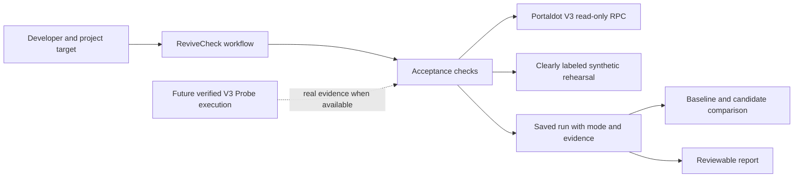

# ReviveCheck — Week 2 Check-in draft

Check-in packet updated on 2026-10-23 after a complete 26-test run, production build, and public asset readback. **This file is not a submitted Check-in.** Core browser create/edit, synthetic failure/rerun/comparison, and live blocked-state flows have been exercised. Archive/restore, mobile, and JSON/HTML HTTP exports also passed; native browser download completion was not confirmed. Signed deployment is pending test-token funding. See [VALIDATION.md](VALIDATION.md) for exact evidence scopes.

## Project overview

**Name:** ReviveCheck
**Intended track:** Modular Cloud & Middleware; organizer fit confirmation pending.
**One sentence:** Repeatable acceptance checks for Solidity applications moving to Portaldot V3, with a complete failure, repair, rerun, and evidence-comparison workflow.

**Target user:** A Solidity developer migrating an application to V3, and the maintainer reviewing that migration.

**User problem:** A developer can connect to an RPC or obtain a deployment hash without establishing that the intended network, mapped account, funding, and contract behavior agree. Individual logs also make it hard to explain what changed after a repair.

**Portaldot integration:** The prototype targets V3 network identification, native/EVM account checks, test-token readiness, and revive contract acceptance. It is based on the officially recommended guide and the October 16 endpoint update. Actual feature status appears below.

## Progress and evidence ledger

| Item | Current status | Evidence or remaining work |
| --- | --- | --- |
| Current rules, milestones, and public project review | Completed research | [Participation research](../PARTICIPATION_RESEARCH.md); read October official announcements rather than applying the April/May FAQ |
| Live native/EVM checkpoint | Passed read-only check | [Raw diagnostic](../artifacts/live-readonly.json): chain identity and finalized checkpoint at height `155464` passed; its other five checks are blocked. This is not a passing live release or signed deployment |
| Product lifecycle and differentiation | Drafted | [Product brief](PRODUCT.md); user validation pending |
| Project creation and reusable target | Create/edit/archive/restore passed in browser | Local API and React UI support a reusable versioned target; history remained available while archived and after restore |
| Live read-only network/account checks | Network/checkpoint verified live; blocked-state browser flow passed | Runtime account mapping, funding, code/value, and supplied-transaction checks are implemented; missing evidence stayed blocked in the exercised browser flow |
| Failure → correction → rerun | Backend regression and synthetic browser flow passed | Each run preserves its input snapshot; synthetic fixture results remain separate from live acceptance |
| Synthetic lifecycle rehearsal | Implemented; focused regression passed | Deterministic wrong-network, corrected, and missing-code fixtures exercise the workflow; they respect the saved chain expectation but execute no local EVM or Probe contract |
| Saved history and comparison | Focused regressions and comparison browser flow passed | Changing the account, contract, or expected value requires a new baseline; an expected-chain correction carries an explicit configuration-correction caveat |
| Exported JSON and HTML reports | HTTP and CLI verification passed | Both endpoints returned attachment content; the exported JSON fingerprint verified. HTML identifies its fingerprint as referring to companion JSON. Native Chrome download completion was not confirmed |
| Test wallet setup | Completed operational step; private material excluded | The coordinating workstream confirmed creation and storage in the user's designated private notes; no wallet secrets or private-note contents are included here |
| tPOT support ticket | Created; request delivery **not confirmed** | Ticket `1295` exists. Messages were removed and a later attempt triggered another approximately five-minute timeout. Automated retries stopped; user assistance with support is required. No delivered funding request is claimed |
| tPOT receipt | **Not funded at the latest check: 0 tPOT** | Recheck the actual test-account balance after a confirmed request or distribution; ticket creation is not receipt |
| Probe deployed on Portaldot V3 | **Pending** | No contract address or transaction is claimed in this draft |
| V3 write and readback | **Pending** | Requires a real deployed target and linked transaction/readback evidence |
| Constructor failure/correction | Real unsigned runtime simulation recorded | [Dry-run artifact](../artifacts/constructor-dryrun.json) reproduces `EvmConstructorNonEmptyData` and corrected EVM initcode encoding using the public guide's origin; no persistent deployment or signed write is proved |
| Public GitHub repository | **Published and anonymously verified** | [a252937166/ReviveCheck](https://github.com/a252937166/ReviveCheck); default branch main preserves the genuine development history |
| Genuine development history | Original three commits publicly preserved, plus publication materials | Product contract, implementation, and validation/materials are distinct records; organizer evaluation remains pending |
| Video of at most three minutes | **Published and anonymously verified** | [Watch](https://a252937166.github.io/ReviveCheck/) / [direct MP4](https://a252937166.github.io/ReviveCheck/check-in.mp4). [check-in.mp4](../video/check-in.mp4): 78 seconds, 1080p/30fps, silent actual-UI screenshots with English captions; HyperFrames/decode review passed. It is a screenshot walkthrough, not a continuous interaction recording |
| Pitch Deck | Completed; public PDF provided | [Six-page Check-in Deck](../artifacts/ReviveCheck-Check-in-Deck.pdf), with editable PPTX companion |
| External developer validation | Pending | One independent builder bringing their own target is the first adoption test |
| Event registration | Completed with UI readback | The coordinating workstream confirmed the platform displayed “Unregister” and “Congratulations” after registration |
| Check-in submission | **Pending** | Registration does not establish that this Check-in was submitted or approved |

This validation pass reran the complete `npm test` suite: **26 passed, 0 failed, 0 skipped**. `npm run build` also passed with Vite `7.3.7`. The suite includes comparison/rehearsal and both H160 reverse-mapping regressions. ffprobe independently confirmed the local video as H.264, 1920×1080, 30 fps, exactly 78.000 seconds, with no audio stream. Detailed manual results and evidence limits are listed in [VALIDATION.md](VALIDATION.md). No private wallet material appears in the public-facing artifacts.

## Demonstrable flow to verify before submission

1. Create a migration project with an explicitly wrong expected chain ID.
2. Run a live read-only check and show the observed network and the failed expectation.
3. Correct the same project's configuration and rerun.
4. Show the previous run alongside the new run; explain that a configuration issue was corrected.
5. Run the synthetic lifecycle rehearsal if testnet deployment is unavailable, with its fixture mode visible; do not describe it as actual local Probe execution.
6. Save or export the run and show what a maintainer can review next.
7. If a real V3 deployment becomes available, show its address, transaction, write, and readback as a distinct execution milestone.

Record only the steps the application can actually perform. A filmed local rehearsal cannot be presented as V3 deployment. A live network read cannot be presented as a signed interaction.

## Remaining work

- Obtain tPOT, deploy Probe, perform one write and readback, and preserve the evidence if time permits.
- Confirm late-entry/Check-in eligibility and treatment of delayed test-token distribution with the organizer.
- Ask a builder to try their own target before expanding the acceptance suite.

## Implemented architecture

The local UI, API, adapters, history, comparison, and export are implemented. Signed V3 Probe execution remains the separate pending milestone. Detailed runtime components appear in the README.

## Links to complete before platform submission

- Public repository: https://github.com/a252937166/ReviveCheck .
- Tested implementation revision: `a07a912` (implementation tested; public repository available).
- Public video player: https://a252937166.github.io/ReviveCheck/ .
- Direct video: https://a252937166.github.io/ReviveCheck/check-in.mp4 .
- Public Pitch Deck: https://github.com/a252937166/ReviveCheck/blob/main/artifacts/ReviveCheck-Check-in-Deck.pdf .
- Testnet contract address: pending.
- Testnet transaction and readback evidence: pending.
- Example exported run: [example-live-report.json](../artifacts/example-live-report.json), fingerprint verified, live status blocked.

## Deadline and request for clarification

The official Check-in deadline is **October 24, 2026, 12:00 UTC / 08:00 EDT / 20:00 Shanghai**. Final submission and code freeze are **November 6, 04:00 UTC / November 5, 23:00 EST / November 6, 12:00 Shanghai**.

If tPOT or deployment remains pending, disclose that status and ask whether the working prototype plus explicit outstanding evidence is acceptable at Check-in. Preliminary mock data being allowed does not amount to an organizer exemption from the V3 integration requirement.

Sources: [DoraHacks rules](https://dorahacks.io/hackathon/portaldot-hacker-house-2026/detail), [October 21 Check-in announcement](https://discord.com/channels/1440212664751099996/1506204427651125349/1562526145373544599).
