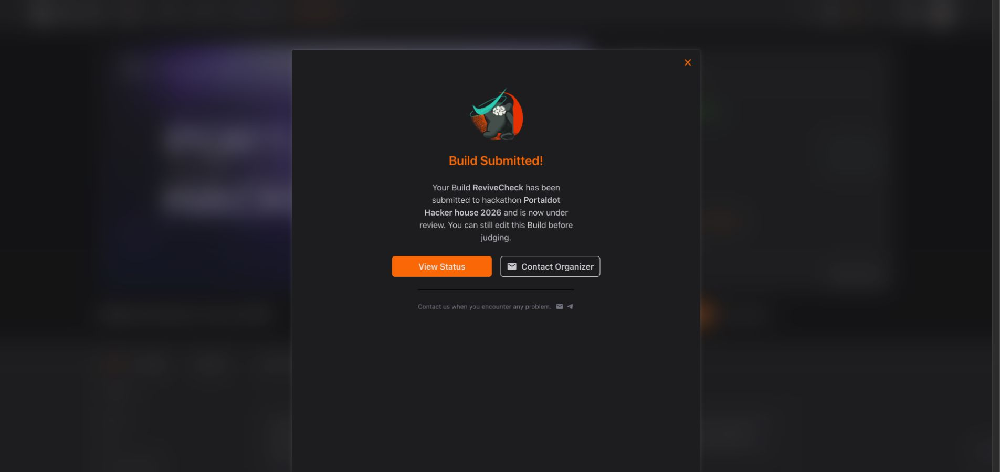

# ReviveCheck — Check-in submission record

**Submitted for review.** DoraHacks displayed **Build Submitted!**, then the event list displayed **Your Build / Under Review** with the intended track. Confirmed on 2026-10-23 at 05:08 UTC / 01:08 EDT / 13:08 Shanghai. This is a platform submission receipt, not organizer acceptance or a completed testnet deployment.

- Build ID: **50176**
- [ReviveCheck on DoraHacks](https://dorahacks.io/build/50176)
- Event: [Portaldot Hacker house 2026](https://dorahacks.io/hackathon/portaldot-hacker-house-2026/detail)
- Track: **Modular Cloud & Middleware**
- Team: one actual account; looking for teammates: **No**
- Status: **Under Review**
- The platform says the Build can still be edited before judging.

## Submitted public assets

- [Public source and README](https://github.com/a252937166/ReviveCheck), with original development commits preserved.
- [78-second public video player](https://a252937166.github.io/ReviveCheck/) and [direct MP4](https://a252937166.github.io/ReviveCheck/check-in.mp4).
- [Six-page Pitch Deck PDF](../artifacts/ReviveCheck-Check-in-Deck.pdf), with [editable PPTX](../artifacts/ReviveCheck-Check-in-Deck.pptx).
- [Verified blocked live report](../artifacts/example-live-report.json) and [unsigned constructor simulation](../artifacts/constructor-dryrun.json).

The public video uses actual prototype screenshots and English captions. Synthetic rehearsal and live read-only observations are labeled separately. The interactive application remains a local workspace with reproducible instructions, rather than a publicly hosted app.

## What was explicitly disclosed

Our own signed Probe deployment, separate state-changing write, and linked finalized readback are **not completed**. No deployed contract address or completed transaction hash was claimed. Retained live evidence establishes V3 identity and a shared finalized checkpoint; missing execution evidence remains blocked. The corrected constructor simulation is unsigned and does not prove persistent deployment or control of its public example origin.

The latest pre-submit account read at 05:04:43 UTC showed **0 tPOT**, **0 available tPOT**, and no established mapping. Test-token support is being handled by the project owner.

The Week 2 progress field was shortened to the platform's actual 960-character limit: the submitted progress is 856 characters, outstanding items 817, and deployment details 869. The form accepted these fields and returned the submission receipt. After submission, Manage Submission redisplayed the correct track, No teammate preference, and Under Review status; its panel does not redisplay the organizer-only answer text. The full Build description was independently reopened and verified, including the missing deployment/write/readback disclosure and the correct repository and video links. The logo, category/tags, and single member were also verified.

## Review and visibility boundary

The Build detail was verified in the submitting account. Anonymous Build visibility has not been independently confirmed. The October 21 organizer announcement says event projects are released after administrator approval; this record does not claim that approval or public event listing has occurred. Repository, video, and Deck assets were independently readable without credentials.

The user explicitly confirmed both **Terms of Use Agreement** and **Participant Agreement** for this creation/submission flow before acceptance. Contact values are excluded from this record.

## Remaining milestones

1. Confirm test-token receipt, then record our own signed deployment, write, finalized receipt, and dual-interface readback.
2. Record the organizer's review decision separately from the platform receipt.
3. Validate the workflow with an external builder's compatible contract before expanding the acceptance suite.

The Check-in deadline is October 24, 12:00 UTC. The event's final code freeze is November 6, 04:00 UTC. Passing Check-in or final eligibility is an organizer decision, not established by successful upload.

## v0.2 publication follow-up

The public root includes the original v0.1 video player and a browser-only report reviewer. The original [#157426 existing-asset report](https://a252937166.github.io/ReviveCheck/?report=15baa9e1d2e8746bdc94b873e314a3fd839fbd52ecc13dd99470bec8444ba544#/review) remains unchanged. The later [current baseline](https://a252937166.github.io/ReviveCheck/?report=0272674216c3687911b6e97349414d39a31eb49c8173c02919262dfafc9dc0d5#/review), hash `0272674216c3687911b6e97349414d39a31eb49c8173c02919262dfafc9dc0d5`, retains **3/3 passed** at native block **157790**, runtime **3002**, with an [immutable baseline manifest](../public/baselines/current-2026-10-23.json).

Anonymous browser checks verified that current report and its correct official native block detail. Official native block/extrinsic routes have actual router/API evidence. H160 QR codes encode matching observed addresses as **Address only**; EVM transaction QR codes, when supported by actual receipt evidence, encode **Hash only** because the current official explorer has no enabled verified detail route for them. Missing own contract and transaction evidence stays pending; the public pUSD precompile is an external system target, not our deployment.

An actual browser review receipt was created, downloaded and imported into an isolated demo workspace. This verifies the internal handoff and exact-report binding, not an authenticated independent reviewer or adoption. Current automated validation is **85/85 tests passed**. The later minimal environment observation at **2026-10-23 04:49 EDT**, block **158114**, found the same environment; it does not establish a runtime upgrade or live revalidation after a real change.

The new [120-second v0.2 lifecycle walkthrough](https://a252937166.github.io/ReviveCheck/lifecycle-demo-v0.2.mp4) uses actual current UI screenshots, silent English captions and 1080p/30 fps video. Local rendering/QA passed, including decoding both QR codes shown in the video. **Anonymous public delivery is verified:** the complete **2,074,264-byte** download at **2026-10-23 09:04:44.779 UTC** matched local SHA-256 `1a088f929bdbfa3a77609923916a174735d825ea5920865423a44424dcfbaf04`; the public browser player then loaded **120 seconds at 1920×1080** at **09:05:53.734 UTC**. See [the video record](DEMO_V2.md) and [publication receipt](../artifacts/v0.2-lifecycle-public-readback.json). It is a progress walkthrough, not evidence of completed own chain execution or a recheck after actual environment drift. It supplements the source/viewer delivery; it has not replaced the submitted video or been entered into the organizer form.

The original 78-second Check-in video, six-page deck and organizer form are unchanged. The local workbench remains local. Own signed deployment, state writes and finalized dual-interface readback remain pending test-token funding; the latest retained account check at **2026-10-23 09:00:19.771 UTC / 05:00 EDT** was **0 tPOT**, with no deployment/write signing or broadcast. Publishing these supplementary materials does not establish a new organizer decision. See [the separate v0.2 delivery record](RELEASE_V2.md) for evidence and remaining gates.
